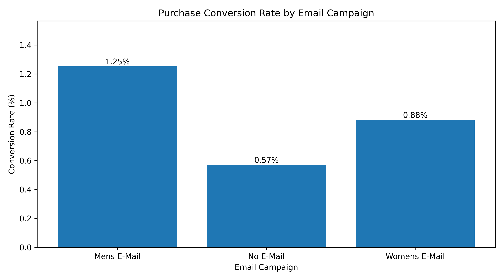
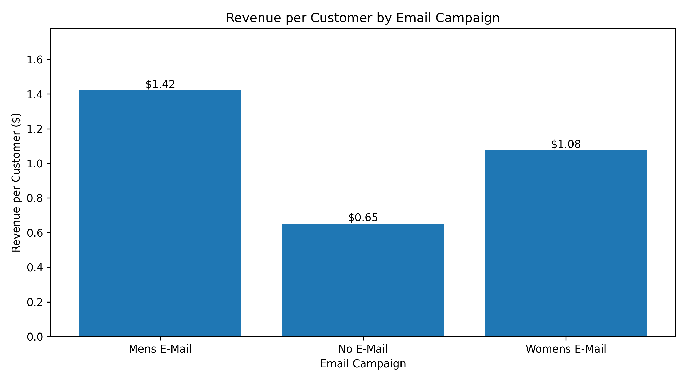

# A/B Testing & Causal Inference: Measuring Marketing Campaign Effectiveness

A Data Science Case Study Using a Randomized Email Marketing Experiment with 64,000 Customers**

1. Executive Summary

How can businesses determine whether a marketing campaign genuinely drives additional purchases rather than simply reaching customers who would have purchased anyway?

This project addresses that question through the analysis of a randomized email marketing experiment involving **64,000 customers**.

Using Python, statistical hypothesis testing, confidence intervals, and bootstrap analysis, the project evaluates the impact of promotional email campaigns on customer purchase behavior and revenue.

Key Findings

| Business Metric | Result |
|---|---|
| Total customers analyzed | 64,000 |
| Experimental groups | 3 |
| Highest-converting campaign | Men's Email |
| Men's Email conversion rate | 1.25% |
| Control conversion rate | 0.57% |
| Estimated absolute conversion lift | +0.681 percentage points |
| Relative conversion improvement | Approximately 119% |
| Conversion hypothesis test p-value | 1.52 × 10⁻¹³ |
| Conversion lift 95% confidence interval | +0.501 to +0.864 percentage points |
| Estimated incremental revenue/customer | +$0.77 |
| Revenue lift 95% bootstrap interval | +$0.484 to +$1.052 |
| Estimated incremental revenue | Approximately $16,403 |

Main takeaway:The Men's Email campaign produced a statistically significant increase in purchase conversions relative to the no-email control group. Bootstrap analysis also supported a positive revenue effect.

The findings suggest that the campaign could generate incremental business value, subject to campaign costs, customer targeting considerations, and profitability assessment.

2. Business Problem

Marketing teams frequently invest in promotional campaigns to improve customer engagement, conversions, and revenue.

However, an increase in observed purchases does not automatically demonstrate that a campaign caused the improvement.

Customers may purchase because of existing preferences, previous shopping behavior, seasonality, or other factors.

This creates an important business challenge:

How can we distinguish the true incremental impact of a marketing campaign from purchases that would have happened without the campaign?

Business Questions

1. Do promotional emails increase purchase conversion rates compared with sending no email?
2. Which email treatment has the highest observed conversion rate?
3. Are observed differences statistically significant?
4. How much incremental revenue does the Men's Email campaign generate?
5. What business actions can be recommended based on the experimental evidence?

3. Dataset Description

Dataset: Hillstrom Email Marketing Dataset

Dataset type:Randomized marketing experiment

Total observations: 64,000 customers

expermental groups:Three

The dataset contains historical customer attributes, randomized email treatment assignments, and subsequent customer outcomes.

Experiment Groups

| Experimental Group | Customers | Treatment |
|---|---:|---|
| Men's Email | 21,307 | Promotional email featuring men's merchandise |
| Women's Email | 21,387 | Promotional email featuring women's merchandise |
| No Email | 21,306 | Control group receiving no promotional email |

Important Variables

| Variable | Description |
|---|---|
| `recency` | Months since a customer's previous purchase |
| `history` | Customer's historical purchase value |
| `history_segment` | Historical spending category |
| `mens` | Indicator for past men's merchandise purchases |
| `womens` | Indicator for past women's merchandise purchases |
| `zip_code` | Customer geographic classification |
| `newbie` | Indicator for new customers |
| `channel` | Customer acquisition or purchase channel |
| `segment` | Assigned experimental treatment |
| `visit` | Whether the customer visited the website |
| `conversion` | Whether the customer made a purchase |
| `spend` | Customer spending after the campaign |

Outcome Variables

Primary outcome: Purchase conversion.
Conversion is a binary variable:

 `1` = Customer made a purchase
 `0` = Customer did not make a purchase

Secondary outcome: Revenue per customer.

Revenue per customer includes customers with zero purchases, allowing a comparison of average revenue across randomized groups.

4. Technology Stack

| Technology | Purpose |
| Python | Primary analysis and programming language |
| Pandas | Data manipulation, aggregation, and exploratory analysis |
| NumPy | Numerical computations and bootstrap sampling |
| Matplotlib | Business metric visualizations |
| Statsmodels | Hypothesis testing and confidence interval estimation |
| Google Colab | Cloud-based Python notebook environment |
| GitHub | Version control, documentation, and project presentation |

Statistical Methods

- Randomized controlled experiment analysis
- Descriptive statistics
- Conversion rate estimation
- Two-proportion Z-test
- Null and alternative hypothesis testing
- Confidence interval estimation
- Bootstrap resampling
- Average treatment effect estimation through group differences
- Business impact quantification

5. Analytical Methodology

The analysis follows a structured approach designed to translate experimental data into business recommendations.

Phase 1: Data Exploration

Loaded the dataset into Pandas and examined its structure.

Validated the number of observations, available variables, and experimental treatment groups.

Phase 2: Conversion Analysis

Measured conversion rates across the three experimental groups.

The conversion rate was calculated as:

Conversion Rate = Number of Purchasing Customers / Total Customers × 100

Phase 3: Hypothesis Testing

Performed a two-sided two-proportion Z-test comparing the Men's Email treatment group against the No Email control group.

Null Hypothesis (H₀):

The Men's Email and No Email groups have equal purchase conversion probabilities.

Alternative Hypothesis (H₁):

The purchase conversion probabilities differ between the two groups.

A significance level of 0.05 was used.

Phase 4: Conversion Lift Estimation

Calculated the absolute and relative differences in conversion rates.

Absolute Lift = Treatment Conversion Rate − Control Conversion Rate

Relative Lift = Absolute Lift / Control Conversion Rate × 100

Phase 5: Confidence Interval Estimation

Calculated a 95% confidence interval for the conversion-rate difference using the Newcombe method.

This provides an uncertainty range around the estimated conversion lift.

Phase 6: Revenue Impact Analysis

Compared average revenue per customer between treatment and control.

Revenue Lift per Customer = Treatment Average Revenue − Control Average Revenue

Estimated the incremental revenue attributable to the Men's Email treatment by multiplying the revenue lift per customer by the number of treatment customers.

Phase 7: Bootstrap Revenue Analysis

Applied 2,000 bootstrap resamples using NumPy to estimate uncertainty in the difference in average revenue per customer.

A fixed random seed was used for reproducibility.

The 2.5th and 97.5th percentiles of the bootstrap distribution were used to construct a 95% percentile confidence interval.

6. Exploratory Analysis and Campaign Performance

Conversion Performance

| Campaign | Customers | Purchases | Conversion Rate |
| Men's Email | 21,307 | 267 | 1.25% |
| Women's Email | 21,387 | 189 | 0.88% |
| No Email | 21,306 | 122 | 0.57% |

Conversion Rate Visualization

  
Interpretation

The Men's Email group achieved the highest observed conversion rate, followed by Women's Email and the No Email control group.

The results suggest that receiving promotional emails may improve customers' likelihood of purchasing.

However, observing higher conversion rates alone does not establish statistical significance. A formal hypothesis test is necessary to assess whether the differences are consistent with a genuine treatment effect.

7. Statistical Hypothesis Testing

Men's Email vs. No Email

The two-proportion Z-test returned:

| Statistical Measure | Result |
| Z-statistic | 7.3851 |
| P-value | 1.523 × 10⁻¹³ |
| Significance level | 0.05 |
| Statistical decision | Reject H₀ |

nterpretation

The p-value is substantially below 0.05, providing strong evidence against equal conversion probabilities.

Because customers were randomly assigned to experimental groups, the observed difference can be interpreted as evidence of a positive causal treatment effect, subject to the experimental design assumptions.

The experiment therefore supports the conclusion that the Men's Email treatment increased purchase conversion compared with the control group.

8. Conversion Lift and Confidence Intervals

Estimated Treatment Effect

Absolute conversion lift: +0.681 percentage points

Relative conversion lift: approximately +119%

95% Confidence Interval

+0.501 to +0.864 percentage points

This interval lies entirely above zero, supporting a positive conversion effect.

Business Interpretation

The estimated improvement corresponds to approximately 6.81 additional purchases per 1,000 customers exposed to the Men's Email treatment compared with the no-email baseline.

The estimate describes the average effect observed in this experimental population. Effects may differ in future campaigns or customer populations.

9. Revenue Impact Analysis

Purchase conversions represent only one dimension of marketing performance.

A campaign may increase conversion rates without necessarily improving revenue or profitability.

To investigate financial impact, this analysis also evaluates average revenue per customer.

Revenue Comparison

| Campaign | Average Revenue per Customer |
|---|---:|
| Men's Email | $1.42 |
| Women's Email | $1.08 |
| No Email | $0.65 |

Revenue per Customer Visualization

Estimated Incremental Revenue

Average revenue improvement:Approximately $0.77 per customer.

Estimated incremental revenue: $16,402.71 across the Men's Email treatment group.

This estimate represents the additional revenue implied by the observed difference in average spending between treatment and control customers.

It does not represent incremental profit.

10. Bootstrap Analysis: Revenue Uncertainty

To quantify uncertainty in the revenue effect, 2,000 bootstrap resamples were generated independently within the Men's Email and No Email groups.

Results

| Metric | Result |

| Revenue lift per customer | +$0.77 |
| Bootstrap iterations | 2,000 |
| Lower 95% confidence bound | +$0.484 |
| Upper 95% confidence bound | +$1.052 |

Interpretation

The bootstrap confidence interval lies above zero, supporting a positive revenue effect for the Men's Email campaign relative to No Email.

The result suggests that the observed financial improvement is not solely explained by ordinary sampling variability under the bootstrap assumptions.

However, additional information about campaign costs, discounts, contribution margins, and delivery expenses would be required to evaluate profitability.

11. Business Recommendations

Recommendation 1: Consider Further Deployment of the Men's Email Campaign

The Men's Email treatment produced positive conversion and revenue estimates compared with the control.

The results support further consideration of the campaign, subject to cost and operational constraints.

Recommendation 2: Evaluate Incremental Profitability

Before expanding the campaign, measure:

- Email campaign operating costs
- Marketing platform expenses
- Product contribution margins
- Promotional discount costs
- Revenue and profit per customer

A campaign should ultimately be judged by incremental business value, not conversion rate alone.

Recommendation 3: Evaluate Customer Segments

Future analysis could examine treatment effectiveness across:

- New versus returning customers
- Historical purchase value segments
- Previous merchandise preferences
- Customer acquisition channels
- Geographic classifications

Subgroup comparisons should use appropriate statistical safeguards to avoid misleading conclusions from multiple tests.

Recommendation 4: Compare All Experimental Treatments

Although Men's Email achieved the highest observed revenue and conversion rates, additional formal testing is required to evaluate differences between Men's Email and Women's Email.

A full campaign recommendation should consider all experimental arms and adjust for multiple comparisons where appropriate.

12. Limitations

This analysis has several important limitations:

Historical dataset: Results reflect the customers and marketing context captured by the experiment.

External validity: Treatment effects may differ across organizations, customer populations, products, or periods.

Revenue versusprofit: Revenue impact does not include marketing costs or product margins.

Incomplete pairwise comparisons: The formal hypothesis test and confidence intervals reported here focus on Men's Email versus No Email.

Bootstrap uncertainty: The bootstrap interval provides an estimated sampling-uncertainty range and depends on resampling and experimental assumptions.

Customer segmentation: Treatment-effect differences across customer subgroups have not yet been evaluated.

13. Future Enhancements

The project could be extended through:

1. Pairwise comparisons of all three experimental groups with multiple-testing adjustments.
2. Customer-level heterogeneous treatment effect analysis.
3. Segment-based uplift modeling.
4. Campaign profitability and cost-benefit simulation.
5. Additional visualizations of bootstrap distributions.
6. Sensitivity checks and validation of experiment assumptions.

These are proposed extensions and are not claimed as completed analyses.

14. Project Notebook

The complete analysis, including Python code, statistical calculations, and visualizations, is available here:

[**View the Complete Python Analysis Notebook**](AB_Testing_Marketing_Analysis.ipynb)

15. Data Source and Attribution

Dataset: Hillstrom Email Marketing Experiment

This publicly available dataset is used for educational purposes to demonstrate randomized experimentation, statistical analysis, and causal effect estimation.

The analysis, interpretation, and documentation presented in this repository constitute a portfolio learning exercise. The dataset was not collected by the repository author.

16. Conclusion

This project demonstrates how randomized experiments can help organizations measure the incremental effects of marketing interventions.

Through Python-based statistical analysis, the project identified a significant positive conversion effect for the Men's Email campaign and estimated a corresponding improvement in average revenue per customer.

The case study highlights the importance of moving beyond descriptive metrics toward statistical evidence, uncertainty quantification, and actionable business insights.

Core competencies demonstrated: Python, statistical hypothesis testing, randomized experimentation, causal effect estimation, bootstrapping, data visualization, and business analytics.
